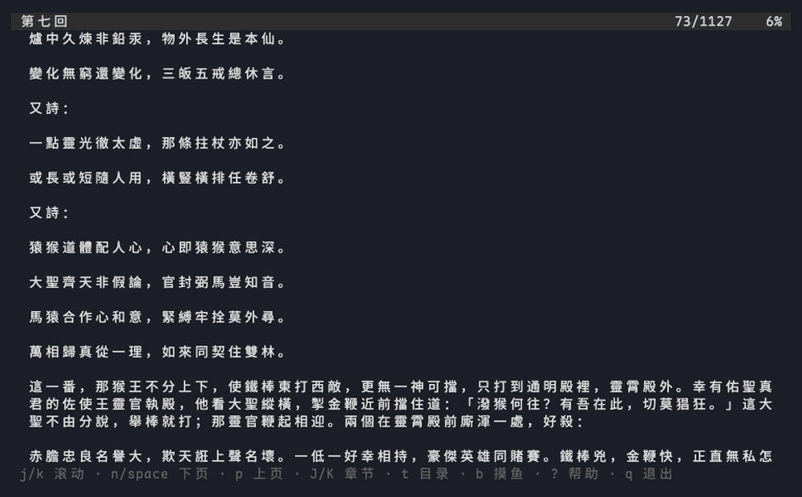

# decoy

[](go.mod)
[](LICENSE)
[](#安装)
[](https://github.com/charmbracelet/bubbletea)
[](https://github.com/ArkURL/decoy/stargazers)
[](https://github.com/ArkURL/decoy/commits)

**中文** · [English](README.en.md)

> 终端 EPUB 阅读器，带一个能把界面**伪装成 Claude Code** 的「boss 键」——上班摸鱼读书，看起来在忙。

`decoy` 是一个用 Go + [Bubble Tea](https://github.com/charmbracelet/bubbletea) 写的终端 EPUB 阅读器。它只做一件事：让你在终端里安静地看书；有人靠近时按一下 `b`，整个界面就变成一段看起来很像正在干活的 Claude Code 会话。

## 特性

- **EPUB 2 / 3 解析**：宽容解析，元数据、目录（NCX 与 EPUB 3 nav）、正文段落都能读；**不支持 DRM**。
- **中文排版正确**：按东亚字符宽度换行，中英混排、emoji 都不会错位。
- **阅读功能**：行滚动、整页翻页、章节跳转、目录、章首页尾、当前页码 / 总页数 / 百分比。
- **进度记忆**：退出、每 10 秒、被 `kill` 时都会保存；下次打开自动回到上次位置（换窗口宽度也能大致还原）。
- **boss 键**：`b` 一键切换伪装界面；内容为英文、每 3 秒自动追加一行、可输入并得到伪回复；**终端标题也会一起伪装**；闲置 30 秒自动触发。
- **可配置**：`idleSeconds`、伪装标题、按键绑定都能通过配置文件覆盖。

## 演示



> 演示用书：《西遊記》（公版，取自中文维基文库）。重新录制：`brew install vhs ttyd ffmpeg` → `./demo/fetch.sh` → `go build -o decoy .` → `vhs demo/demo.tape`；脚本见 [`demo/demo.tape`](demo/demo.tape)。

## 安装

需要 Go 1.27+。

```bash
go install github.com/arkurl/decoy@latest
```

从源码构建：

```bash
git clone https://github.com/ArkURL/decoy.git
cd decoy
go build -o decoy .
```

> 直接把二进制放到 `$PATH` 里即可。macOS / Linux / Windows 均可，Windows 下终端能力以实际终端为准。

## 使用

```bash
decoy /path/to/book.epub
```

只支持单文件打开（暂无书架）。

## 快捷键

阅读界面：

| 按键 | 作用 |
| --- | --- |
| `j` / `k`、`↓` / `↑` | 上/下一行（**只在本章内**滚动） |
| `n`、`space`、`pgdn`、`f` | 下一页（跨章） |
| `p`、`pgup` | 上一页（跨章） |
| `d` / `u`、`ctrl+d` / `ctrl+u` | 半页上/下 |
| `J` / `]`、`K` / `[` | 下一章 / 上一章 |
| `g` / `home`、`G` / `end` | 章首 / 章尾 |
| `t` | 打开目录 |
| `b` | 摸鱼（切到伪装界面） |
| `?` | 帮助 |
| `q`、`ctrl+c` | 退出 |

> 滚到本章末尾时按 `j` 不会跳章（避免打断阅读），状态栏会提示「已到本章末尾 · n 下一页」；要换章请用 `n` / `p`。

boss 界面（伪装屏）：

| 按键 | 作用 |
| --- | --- |
| `b` | 切回阅读（浏览态） |
| `ctrl+b` | **任意状态**下切回阅读（逃生键） |
| `i` / `enter` | 聚焦输入行 |
| `enter` | 发送，稍后追加一段伪回复 |
| `esc` | 退出输入 / 切回阅读 |
| `j` / `k`、`pgup` / `pgdn` | 滚动会话内容 |

## 配置

配置文件为可选，路径取自 `os.UserConfigDir()`：

- Linux：`~/.config/decoy/config.json`
- macOS：`~/Library/Application Support/decoy/config.json`
- Windows：`%AppData%\decoy\config.json`

```json
{
  "idleSeconds": 30,
  "fakeTitle": "~/dev/api — vim",
  "keys": {
    "boss": ["b"],
    "pageup": ["p", "pgup"]
  }
}
```

- `idleSeconds`：闲置多少秒自动切到伪装界面（`0` 关闭）。
- `fakeTitle`：伪装时设置的终端窗口标题。
- `keys`：按**动作名**覆盖按键，值为按键数组。可用动作名：`down` `up` `pagedown` `pageup` `halfdown` `halfup` `nextchapter` `prevchapter` `top` `bottom` `toc` `boss` `bossback` `bossfocus` `help` `quit`。

阅读进度存在同一目录下的 `progress.json`。

## 已知限制

- 仅支持 **EPUB**（不支持 mobi/azw3），且**不支持 DRM**。
- 图片、表格会降级为纯文本；暂无全书搜索、书签/高亮。
- 正文里的脚注 / 内部链接暂不可跳转。
- 窗口宽度变化时会重排全书以算页码（大书可能有几十毫秒的停顿）。

## 开发

```bash
go build ./...      # 构建
go test ./...       # 测试
go vet ./...        # 静态检查
gofmt -l .          # 格式检查
```

项目结构：

```
main.go              # 入口：解析参数、载入配置、启动 Bubble Tea
internal/epub/       # 宽容的 EPUB 2/3 解析（container / OPF / spine / NCX / nav / 正文）
internal/render/     # 按东亚宽度换行 + 布局与阅读位置换算
internal/reader/     # 阅读视图：滚动/翻页/章节/目录/页码
internal/boss/       # boss 键的伪 Claude Code 界面
internal/storage/    # 阅读进度 JSON 持久化
internal/config/     # 配置与键位映射
internal/app/        # 根模型：模式切换、标题伪装、闲置计时
```

## 许可证

[MIT](LICENSE) © 2026 ArkURL
